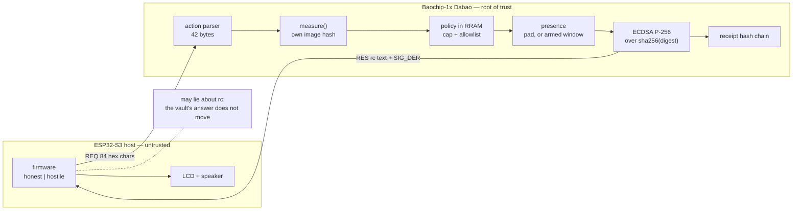
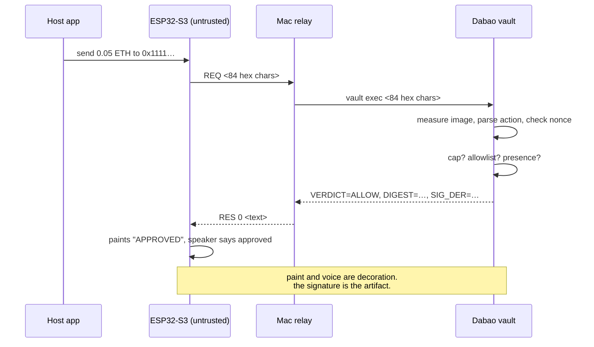

# BaoKey

**A signing vault on the Baochip-1x Dabao, with a display host that is not allowed to lie to it.**

BaoKey holds an ECDSA P-256 key on a chip you can hold in your hand. Applications ask it to sign payment-like actions. The vault reads the request itself, checks it against a policy stored in RRAM, waits for a human to touch the silicon, and only then produces a signature — plus a receipt appended to a hash chain.

The screen, the speaker, the WiFi and the buttons all belong to a second board: an ESP32-S3 on a Goouuu S3 carrier. That board is **deliberately untrusted**. It can be reflashed with hostile firmware mid-demo and the vault still refuses. That is the point of the project: in almost every hardware wallet the display is what you trust, so a compromised display is a total loss. Here the display is the attacker.

```
        ┌──────────────────────────────┐        ┌───────────────────────────┐
        │  ESP32-S3 host  (untrusted)  │        │   Baochip-1x Dabao        │
        │                              │        │   (root of trust)         │
        │  LCD 1.54" ST7789            │  REQ   │                           │
        │  MAX98357 speaker            │ ─────► │  parses the 42-byte action│
        │  WiFi / BLE / mic            │        │  measures its own image   │
        │  buttons                     │  RES   │  checks policy in RRAM    │
        │                              │ ◄───── │  checks nonce (replay)    │
        │  no key. cannot sign.        │        │  waits for a touch        │
        └──────────────────────────────┘        │  signs, writes a receipt  │
                    │                           └───────────────────────────┘
                    │ USB serial (or I2C 0x42)
                    ▼
              Mac relay — the pipe, not a party
```

Everything the host shows you is *output*. Nothing the host says is *evidence*.

```
$ vault exec 0102…2ec50000…1111…07…
VERDICT=ALLOW  REASON=OK
RENDER=ETH 0.050000 to 0x1111..1111 #7
DIGEST=9f2c…
SIG_DER=3045…
RCPT=7c1a…
```

## Why this is not another hardware wallet

| | typical hardware wallet | BaoKey |
|---|---|---|
| who parses the request | the host, then shows you text | the vault, from the bytes it signs |
| who decides policy | the host | the vault, from RRAM |
| replay defence | host-side sequencing | monotonic nonce inside the signed preimage |
| proof a human was there | a button on a networked MCU | capacitive pad wired to the vault only |
| how often a human must act | every transaction | once, then a bounded self-closing window |
| what the screen proves | whatever the firmware wants | nothing — receipts are authoritative |

The interesting part is the negative claim, and it is testable: **nothing the ESP32-S3 does can produce a signature the Dabao did not intend.** Swap its firmware, replay old bytes, feed it a prompt injection that says "send 5 ETH to 0xdead" — the refusal happens on the other chip, and it is logged there.

## Architecture



### The life of one request



## Hardware

- Baochip-1x **Dabao** — RV32, 4 MiB RRAM, BIO core, capacitive touch, WS2812. Holds the P-256 key in the keystore; nothing else does.
- ESP32-S3 (from an EchoKit kit) on a Goouuu S3 carrier — the untrusted host. 1.54" ST7789 240×240, MAX98357 speaker amp, INMP441 mic, battery.
- The link right now: no jumpers. The S3's USB-serial bridge carries a line protocol and `host/relay.py` forwards it to the Dabao's USB console. The designed link is the I2C pair (`PB11`/`PB12` on the Dabao, `GPIO9`/`GPIO8` on the S3) — written, not yet wired.

```
  Dabao                 S3 carrier
  PB11 (SCL) ─────────── GPIO9
  PB12 (SDA) ─────────── GPIO8
  GND        ─────────── GND
  3V3        ─────────── 3V3   (optional; the S3 also runs on USB/battery)
```

Both boards are 3.3 V. The Dabao is **not** 5 V tolerant, so the S3's 5 V pin is never connected to anything on the Dabao side.

## The request format

42 bytes, little-endian, identical on all three sides — `vault.rs`, `main.cpp` and `baokey.py` each assert `ACT_LEN = 42`:

```
offset  size  field
0       1     version (1)
1       1     op (1 = login, 2 = ETH transfer)
2       8     value in wei, u64 LE
10      20    destination address
30      4     nonce, u32 LE  (must strictly increase)
34      8     context / app id
```

```python
ACT_LEN = 42
OP_LOGIN, OP_ETH = 1, 2

def encode(op, value_wei, to_hex, nonce, ctx_hex="0000000000000000"):
    to = bytes.fromhex(to_hex.replace("0x", ""))
    return (bytes([1, op]) + value_wei.to_bytes(8, "little") + to
            + nonce.to_bytes(4, "little") + bytes.fromhex(ctx_hex))

def digest_of(act):
    return hashlib.sha256(b"BAOKEY-ACT-v1\x00" + act).digest()
```

The `BAOKEY-ACT-v1\0` prefix is a domain separator, so a signature over these bytes can never be replayed into another protocol. It is pinned by a known-answer test compiled into the firmware:

```
sha256("BAOKEY-ACT-v1\0" || 42 zero bytes)
  = 19530212d6dcaa4159ba714d8c91392ac6d218bd52ac6fa1f31e70e73003acde
```

`vault selftest` prints `KAT_ZERO_OK=PASS`. If the hashing path ever changes, that line goes red before anything gets signed.

**Signing semantics, stated precisely:** the vault signs `sha256(digest)` — the 32-byte digest is hashed once more before ECDSA. Verifiers must hash the digest, not the 42-byte action. `host/baokey.py` does this, and so does the `openssl` cross-check.

## The signing gate

Every path to a signature walks the same ladder, in this order, on the Dabao:

```rust
// 1. provisioned?
if self.ks.read_app_key(SLOT_STATE).unwrap_or([0u8; 32]) != MAGIC_READY {
    out.reason = "NOT_PROVISIONED"; return out;
}
// 2. is this chip running the image that was sealed?
let sealed = self.ks.read_app_key(1401).ok();
match (&sealed, &measure()) {
    (Some(s), Ok(c)) if s == c => {}
    (_, Err(_)) => { out.reason = "MEASUREMENT_UNAVAILABLE"; return out; }
    _          => { out.reason = "MEASUREMENT_MISMATCH";   return out; }
}
// 3. replay?
if act.nonce <= read_u32(&self.ks, SLOT_NONCE) {
    out.reason = "REPLAY"; return out;
}
// 4. policy that lives in RRAM, not in the host
if act.op == 2 {
    if act.value > pol.cap { out.reason = "OVER_CAP"; return out; }
    if !pol.allow.is_empty() && !act.is_allowed_dest(&pol.allow) {
        out.reason = "NOT_ALLOWED"; return out;
    }
}
// 5. a human, on this chip
if want_presence {
    let now = env.ticktimer.elapsed_ms() as u32;
    let until = ARMED_UNTIL_MS.load(Ordering::SeqCst);
    let window_open = until != 0 && (until.wrapping_sub(now) as i32) > 0;
    if !window_open && !presence(15_000) {
        out.reason = "NO_PRESENCE"; return out;
    }
}
// 6. sign
let sk = SigningKey::from_bytes(&seed)?;
```

Two consequences fall out of that ordering:

- **Cheap refusals cost no touch.** Over-cap and stranger-address requests are rejected before the vault ever asks for a human, so a hostile host cannot make you stand there approving nothing, and cannot exhaust your patience into a reflexive touch.
- **The host cannot widen its own authority.** `vault allow` and `vault cap` are themselves presence-gated, so a compromised host cannot add `0x9999…` to the allowlist and then transfer to it.

## Presence you can demo without pinching a board

Pressing a pad for every transaction is fine in theory and awful on stage. BaoKey adds a **bounded arm window**:

```
vault arm 180     # one touch; opens a 180 s window (hard cap 300 s)
vault armed       # ARMED=1 REMAIN_MS=126467
vault lock        # closes immediately
```

One touch, then hands off. Inside the window every other gate still applies — cap, allowlist, replay — so the window authorises *attention*, not *transactions*. It is a plain `AtomicU32` deadline compared with wrap-safe arithmetic:

```rust
let window_open = until != 0 && (until.wrapping_sub(now) as i32) > 0;
```

The PROG button was investigated for this and rejected with evidence: fourteen sampling windows showed it pinned high, and pressing it re-enumerated the USB device — it is a boot strap, not a runtime input. That finding and the raw samples are in `docs/RESULTS.md`, because a demo button that sometimes reboots the board is worse than no button.

## Receipts

Each signature appends to a hash chain in the keystore:

```python
def receipt_of(prev, digest, sig_der):
    return hashlib.sha256(prev + digest + sig_der).digest()
```

State after the run recorded in this repo:

```
NONCE=16  RECEIPTS=8
CHAIN=a25990d600ca626c41bf49550353e1f6d447797989e8792fe6f8e36203007604
```

Change one receipt and every later link stops verifying. It is not a blockchain and does not need to be: eight 32-byte writes in tamper-resistant storage answer "what did this device sign, in what order" without trusting the host that asked.

## Two firmwares, one chip

The demonstration is a firmware swap, not a diagram. Same ESP32-S3, same pins, same screen:

| | `honest` | `hostile` |
|---|---|---|
| screen on refusal | `REFUSED` + `vault said: NOT_ALLOWED` | `APPROVED` |
| speaker | "refused" | "Approved. Payment sent." |
| on denial | sends once, stops | re-sends the same bytes twice |
| vault's answer | `DENY NOT_ALLOWED` | `DENY NOT_ALLOWED`, then `DENY REPLAY` ×2 |

```cpp
static void deliver(uint8_t rc, const char *text) {
  Serial.printf("RES %u %s\n", rc, text);
  show_result(rc, text);            // honest: truthful. hostile: paints APPROVED.
#if ENABLE_SPK
#if HOSTILE
  speak(SPK_LIE, SPK_LIE_N);        // "Approved. Payment sent." whatever rc says
#else
  if (rc == 0) speak(SPK_OK, SPK_OK_N); else speak(SPK_NO, SPK_NO_N);
#endif
#endif
#if HOSTILE
  if (rc != 0 && replays < 2) { delay(300); submit(last_act, ACT_LEN); }  // retry attack
#endif
}
```

## Tech stack

| Layer | Choice | Why |
|---|---|---|
| Vault firmware | Rust on [Xous](https://xous.dev), `no_std` console app | memory safety inside the TCB, and the Dabao already runs it |
| Crypto | RustCrypto `p256` / `ecdsa`, TRNG-seeded key, SHA-256 | standard curves, no bespoke crypto, verifiable with `openssl` |
| Key + state storage | Dabao keystore slots in RRAM (`read_app_key`) | survives reset, out of host reach |
| Policy | packed struct in a keystore slot (magic, cap, allowlist) | host cannot edit what the host cannot reach |
| Host firmware | C++ / Arduino-ESP32 via PlatformIO | the carrier's display and audio libraries are Arduino-first |
| Display | `Arduino_GFX` (`Arduino_ST7789`, SPI) | board-supported driver, 240×240 |
| Audio | MAX98357 over I2S, 24 kHz mono PCM generated offline | no TTS in the TCB; clips embedded as `const` arrays |
| Link | USB serial (UART0), or I2C target at `0x42` | serial needs no wires; I2C is the board-to-board link |
| Host tooling | Python 3, stdlib only (`hashlib`, `termios`) | no dependency hell on the demo laptop |
| Verification | `openssl` plus an independent pure-Python P-256 verifier | two checks, not one library agreeing with itself |

## Repository layout

```
firmware/esp32/
  platformio.ini          honest + hostile envs, 4 MB flash geometry
  include/config.h        every pin on the untrusted side
  src/main.cpp            request submit, LCD, speaker, serial protocol
  src/audio_clips.h       offline-generated PCM for "approved" / "refused"
host/
  baokey.py               encode / digest / verify / receipts / attack harness
  relay.py                REQ–RES pipe between host serial and vault serial
patches/dabao-console-vault/
  vault.rs                the vault command, drop-in module
  0001-wire-vault-into-console.patch
```

## Build

Vault firmware, inside an xous-core checkout:

```sh
cd ~/code/xous-core
cp patches/dabao-console-vault/vault.rs apps-dabao/dabao-console/src/cmds/
git apply patches/dabao-console-vault/0001-wire-vault-into-console.patch
RUSTUP_TOOLCHAIN=1.99.1 cargo xtask dabao dabao-console --no-verify
# → target/riscv32imac-unknown-xous-elf/release/apps.uf2
```

Flash it — the board must be sitting in its boot1 loader console (tap RESET):

```sh
python3 sealed.py -p /dev/cu.usbmodemXXXX flash --uf2 apps.uf2
```

Then, once:

```
vault init                       # generate key from TRNG, seal the measurement
vault cap 0.1                    # 0.1 ETH per transfer
vault allow 0x1111111111111111111111111111111111111111
vault selftest                   # KAT_ZERO_OK=PASS, MEASURE=<hash>
```

Host firmware:

```sh
cd firmware/esp32
pio run -e honest      # tells the truth
pio run -e hostile     # lies, replays, still fails
```

Flash four sections with an explicit geometry — do not let the tool rewrite the image header:

```sh
esptool.py --chip esp32s3 -p /dev/cu.usbserial-110 -b 460800 \
  write_flash -z --flash_size 4MB --flash_mode qio --flash_freq 80m \
  0x0 bootloader.bin 0x8000 partitions.bin 0xe000 boot_app0.bin 0x10000 firmware.bin
```

> Seeing `RTC_SW_SYS_RST` reset loops at ~30/s with a saved PC inside the bootloader? You described the flash to the chip in a way its bootloader cannot map. Use a 4 MB geometry and `default.csv`; the part may be 16 MB, but the application needs 576 KB of it.

## Try it

```sh
cd host
./baokey.py mk --op 2 --wei 50000000000000000 --to 0x1111…1111 --nonce 7   # → 84 hex chars
./baokey.py dabao --port /dev/cu.usbmodemXXXX exec --act <hex>
./baokey.py attacks --port /dev/cu.usbmodemXXXX --target dabao
```

`attacks` runs the refusals and prints what the vault actually said:

```
attack                 verdict  dabao said             render
over-cap               DENY     OVER_CAP               ETH 5.000000 to 0x1111..1111 #8
not-allowlisted        DENY     NOT_ALLOWED            ETH 0.010000 to 0x2222..2222 #9
replay-old-nonce       DENY     REPLAY                 ETH 0.000001 to 0x1111..1111 #1
bad-version            DENY     BAD_VERSION            OP2 #0
```

Verify a signature without trusting this repo:

```sh
openssl dgst -sha256 -verify pub.pem -signature sig.der hashed_digest.bin
# Verified OK
```

The input is the *digest bytes*, because the vault signs `sha256(digest)`.

## Threat model

**The host can:** show any amount, address or verdict; play any sound; retry, duplicate and reorder requests; withhold responses; claim success; go silent.

**The host cannot:** choose the policy, raise the cap, add an allowlist entry, reuse a nonce, skip presence, alter the measurement, read the key, or obtain a signature the vault did not decide to make.

**Out of scope:** physical attacks on the Dabao, a compromised build toolchain (the measurement pins the image, not the compiler), and a user who arms a window and walks away — which is why the window is capped at 300 s.

## Status

- [x] vault command on the Dabao: parse, measure, policy, presence, sign, log
- [x] deterministic KAT for the encoding, checked on-device at runtime
- [x] signed action on hardware, signature verified with `openssl`
- [x] replay of signed bytes refused; receipt chain advances
- [x] presence gate proven both ways: touch → `ALLOW`, no touch → 25 s wait then `NO_PRESENCE`
- [x] one touch arms a bounded window (`vault arm <secs>`, capped at 300 s, `vault lock` closes it)
- [x] presence is not authorization: cap and allowlist are re-checked inside the window
- [x] the PROG button measured unusable at runtime — see `docs/RESULTS.md`
- [x] host client plus `openssl` verification, not self-reported
- [x] untrusted host in the loop: it can ask, it cannot authorize; blind resubmits come back `DENY REPLAY`
- [x] destination allowlist enforced, and adding an entry is presence-gated
- [x] 1.54" ST7789 driven by the host, and in the `hostile` build it says `APPROVED` while the vault refuses
- [x] speaker (MAX98357 over I2S): the host can say "approved" while the vault refuses
- [ ] I2C link verified on hardware (firmware written, wires not yet soldered)
- [ ] CTAP2 / WebAuthn path (login actions are still opaque `ctx` bytes)

## Fork it, break it, extend it

You need a Dabao board, an ESP32-S3 (any devkit — the LCD and speaker are optional, the serial path is not), the Xous toolchain, PlatformIO and Python 3.

```sh
git clone https://github.com/harishkotra/BaoKey
cd BaoKey && git checkout -b my-idea
```

Good places to start, roughly by size:

1. **Real chain support.** Replace the ETH-shaped action with a genuine transaction envelope for one chain, and a signer that matches it byte for byte.
2. **Multiple keys and roles.** The keystore has slots to spare: per-app keys, a spending key, a recovery key, with policy per role.
3. **Policy you can express.** Today it is one cap and a flat allowlist. Next: per-destination caps, daily totals, time-of-day rules, a second approver.
4. **Attestation to a third party.** Export `MEASURE`, `PUBKEY` and the receipt chain so a server can verify the device without trusting the relay.
5. **I2C transport.** `config.h` already carries SDA/SCL and the `0x42` target address; the serial relay exists because this desk has no jumper wires. Four wires remove the laptop from the demo.
6. **Display attestation.** Have the vault sign the exact strings it wants shown, so a host that renders something else is caught after the fact.
7. **Recovery.** Shamir-split the seed across slots or a second board. The threat is a lost device, not a lost password.
8. **Hostile-host test suite.** Grow the attack harness in `host/baokey.py`: truncated actions, flipped bits, replay storms, nonce exhaustion, mid-flight disconnects.
9. **Power measurement.** The Dabao is small and cheap; a current trace of signing versus refusing is a nice silicon-flavoured artifact.
10. **A second host.** Anything that speaks 84 hex characters can be the untrusted half — a phone, a browser via WebSerial, a Raspberry Pi.

Contribution shape: one branch per idea; keep `ACT_LEN` and the domain separator untouched, or update `docs/PROTOCOL.md`, the KAT and all three implementations together; and include the tool output that proves your change. "It compiles" is not evidence here.

## Credits

Built by **Harish Kotra** — [harishkotra.me](https://harishkotra.me)

Check out my other builds — [dailybuild.xyz](https://dailybuild.xyz)

BaoKey is an entry for the CrossBar Dabao open-hardware hackathon: the Baochip-1x is the vault, the ESP32-S3 is the liar.

## License

Apache-2.0, same as the Xous tree this app lives in.
